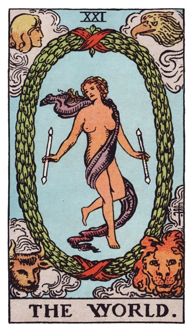
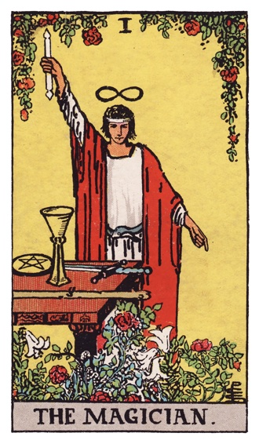
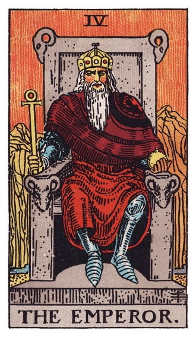
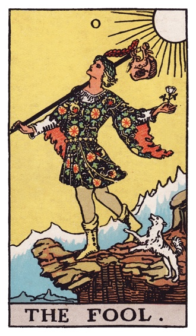
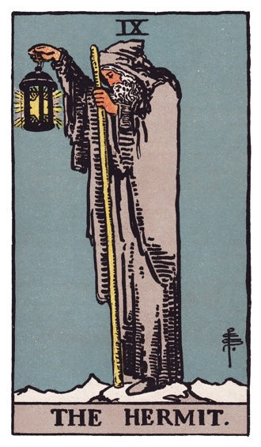
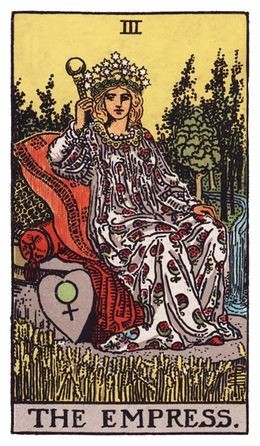
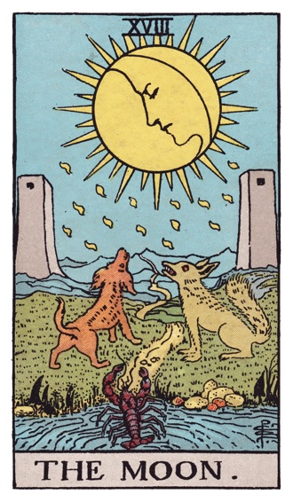
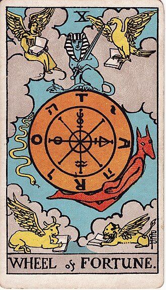
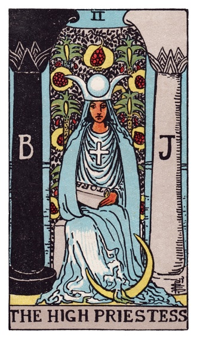

# Unconscious Development

Work that happens below your attention, surfaced only at approval points.

<table>
  <tr>
    <td align="center"></td>
    <td align="center"></td>
    <td align="center"></td>
    <td align="center"></td>
    <td align="center"></td>
    <td align="center"></td>
    <td align="center"></td>
    <td align="center"></td>
    <td align="center"></td>
  </tr>
  <tr>
    <td align="center">Self</td>
    <td align="center">Magician</td>
    <td align="center">Ruler</td>
    <td align="center">Explorer</td>
    <td align="center">Sage</td>
    <td align="center">Creator</td>
    <td align="center">Shadow</td>
    <td align="center">Trickster</td>
    <td align="center">Persona</td>
  </tr>
</table>

A cast of agent archetypes (Self, Magician, Ruler, Explorer, Sage, Creator,
Shadow, Trickster, Persona) runs a loop from approved spec to reviewed
diff. The contract is files and scripts: charters, specs, `🌀 Now/` pages,
`check-spec`, `spec-to-cards`. No harness or UI is a dependency.

Opt-in. Nothing here is loaded by default.

- [docs/Unconscious Development.md](docs/Unconscious%20Development.md): the working doc and current source of truth. As practices get their own file under `docs/`, the matching decisions leave it.
- `docs/archive/`: the interview doc and the composition drafts it grew from. Reference only.

## The cast

| Card | Archetype | Role |
| --- | --- | --- |
|  | Self | You. Approves specs, batches, merges. |
|  | Magician | `chief`. Reads every `PROJECT.md` and `🌀 Now/` page, proposes a batch, turns approved specs into cards. |
|  | Ruler | `lead`. Holds one domain's charter, dispatches, writes specs, makes small changes. |
|  | Explorer | `researcher`. Reads anything, returns paths and lines, answers questions. |
|  | Sage | `planner`. Proposes steps and order, with a reason. |
|  | Creator | `worker`. Changes files, runs tests, reports. |
|  | Shadow | `reviewer`. Sees what the Creator did not want seen; returns per-criterion verdicts with evidence. |
|  | Trickster | verifier. Runs the criteria the Shadow marked `needs-run` and tries to make them fail. |
|  | Persona | A charter or skill. The mask any archetype wears to become a specialist. |

Card images: Rider-Waite deck, 1909, public domain, via Wikimedia Commons.
