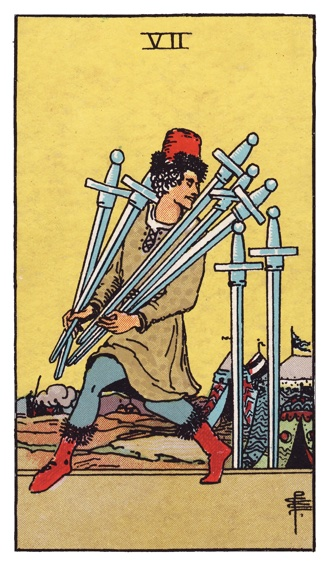

# Unconscious Development

  
  
  
  
  
  
  
  
  

A cast of agent archetypes takes an issue from approved spec to reviewed
diff. You approve the spec and the merge. In between, `spec-to-tasks` splits
the spec into tasks, a Creator implements each task in its own session and
worktree (a vessel), a Shadow checks the diff against the spec's acceptance
criteria, and a Trickster runs the criteria that reading can't settle.

The contract is files and scripts: Personas, specs, `PROJECT.md`, `🌀 Now/`
pages, `check-spec`, `spec-to-tasks`. No harness, tracker or runner is a
dependency.

Opt-in. Nothing here is loaded by default.

- [docs/Unconscious Development.md](docs/Unconscious%20Development.md): the working doc and current source of truth. As practices get their own file under `docs/`, the matching decisions leave it.
- `docs/archive/`: the interview doc and the composition drafts it grew from. Reference only.

## The cast

| Card | Archetype | Role |
| --- | --- | --- |
|  | Self | You. Approves specs and merges. |
|  | Magician | `chief`. Reads every `PROJECT.md` and `🌀 Now/` page, proposes which issues to spec next. |
|  | Ruler | `lead`. Holds one domain's Persona, dispatches, writes specs, makes small changes. |
|  | Explorer | `explorer`. Reads anything, returns paths and lines, answers questions. |
|  | Sage | `sage`. Proposes steps and order, with a reason. |
|  | Creator | `creator`. Changes files, runs tests, reports. |
|  | Shadow | `shadow`. Sees what the Creator did not want seen; returns per-criterion verdicts with evidence. |
|  | Trickster | `trickster`. Runs the criteria the Shadow marked `needs-run` and tries to make them fail. |
|  | Persona | `docs/personas/<domain>.md`. The file any archetype reads first to become a specialist in that domain. |

Card images: Rider-Waite deck, 1909, public domain, via Wikimedia Commons.
