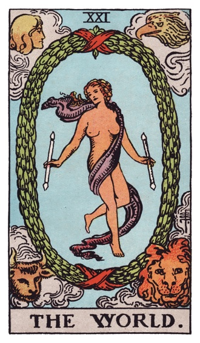
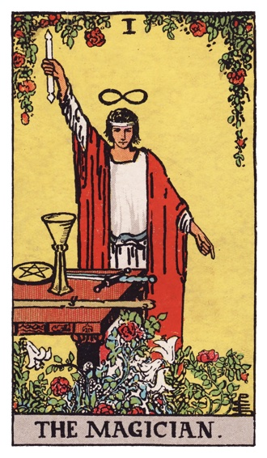
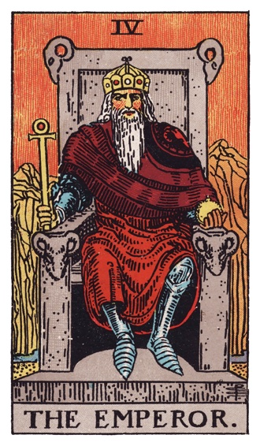
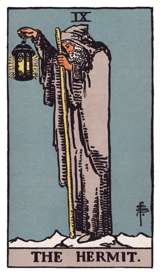
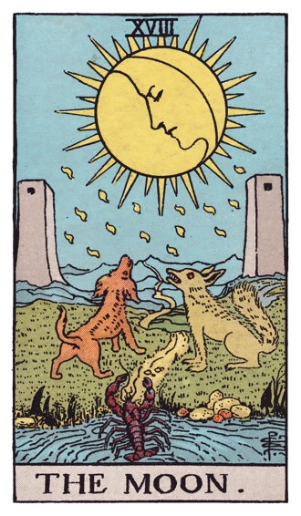

# Unconscious Development

Unconscious Development (UD) takes a GitHub issue from an approved spec to a reviewed pull request, using a set of agent roles called the cast. You make two calls: you approve the spec, and you merge the result.

## How a change moves through it

1. You open an issue, then write its spec and plan with the Ruler on a `spec/<issue>` branch. Each open question in the spec becomes a PR comment thread, and your reply is written into the spec.
2. Merging the spec PR approves it. CI splits the plan into tasks named `gh-<issue>/t1`, `gh-<issue>/t2`, and so on.
3. For each task, a Creator makes the change in its own worktree. A Shadow checks the diff against the spec's acceptance criteria, and a Trickster runs the criteria that reading the code can't settle.
4. You review and merge each task PR. When the last one merges, CI marks the spec built and closes the issue.

A small change skips the spec: its criteria go in the issue body. [Development flow](docs/Development%20flow.md) draws the whole loop.

UD is files and scripts: Personas, specs, and the `bin/unconscious` command. It doesn't depend on any one agent harness, issue tracker, or task runner.

## Try it

You need Node 24, the GitHub CLI logged in, and pi or Claude Code.

To see the reviewer on a PR you already have, run this from that repo:

```sh
~/code/unconscious-development/bin/unconscious review 128
```

The Shadow prints a verdict for each acceptance criterion, with the line of code that settles it. Add `--comment` to post the verdicts on the PR.

To set up a repo and take one change from issue to merged PR, follow the [Quickstart](docs/Quickstart.md). The [Glossary](docs/Glossary.md) explains each name.

## Install the cast

Nothing loads by default. `bin/unconscious enable` installs the roles and skills into every harness on PATH (pi and Claude Code). Add `--harness pi` or `--harness claude` to pick one, and run `bin/unconscious disable` to remove them.

## Commands

Run them from your project's repo. `bin/unconscious help` lists every command, and `bin/unconscious help <command>` shows its options and examples.

| Command | What it does |
| --- | --- |
| `init` | Sets a repo up: `docs/specs/`, a draft Persona, and the CI workflows. Never overwrites a file. |
| `enable`, `disable` | Install or remove the cast in pi and Claude Code. |
| `status` | Shows what's installed and which background jobs are on. |
| `schedule on\|mirror\|off` | Runs the background jobs with launchd (macOS) or systemd (Linux). |
| `check-spec` | Checks the specs and plans in `docs/specs/`. With `--pr N`, explains a failure in a PR comment. |
| `spec-to-tasks N` | Turns issue N's plan into tasks, in Alice if installed, otherwise printed. |
| `on-merge` | After a spec merges, marks its issue `ud:build` and creates its tasks. CI runs it. |
| `task-merged` | After the last task PR of an issue merges, marks the spec built and closes the issue. CI runs it. |
| `draft N` | The Ruler writes criteria for small issue N, or says it needs a spec. |
| `review N` | The Shadow reviews PR N against its criteria. |
| `propose` | Parked. The Magician writes the Proposed next section of each Now page. |
| `questions` | Posts a spec PR's open questions as comments, and writes replies into the spec. |
| `status-page` | Parked. Rebuilds the `🌀 Now/` pages from GitHub. |

## Parked

The Magician (`propose`), `status-page`, the vault mirror, and the `schedule` timers stay in the code, but they're off until the vault's role is decided. Leave `schedule` off. [Who owns what](docs/Who%20owns%20what.md) lists what else is parked.

## Skills

`enable` installs these. In pi, `/issue` and `/build` are also slash commands.

- `issue`: starts the spec flow from an issue id, as in `/issue 6686`. It opens the `spec/<issue>` worktree and makes the session that domain's Ruler.
- `spec`: writes the acceptance criteria, as issue criteria for a small change or as a spec and plan.
- `build`: builds an approved spec's next task in this session, as in `/build 6983`. It sends a Creator, a Shadow, and a Trickster, then opens the task's PR. Use it instead of Alice cards.
- `persona`: drafts a domain's Persona from the code, and promotes the invariants that reviews propose.
- `propose`: the Magician. Writes the Proposed next section of a Now page. Parked.

## CI workflows

`init` copies both into the project repo's `.github/workflows/`.

- `workflows/unconscious.yml` runs `check-spec` on spec PRs and creates tasks when a spec merges.
- `workflows/unconscious-tasks.yml` closes out the issue when its last task PR merges. It runs on every push to the default branch, not only pushes that touch `docs/`, so it's a separate file.

## Comment templates

The comments UD posts come from `templates/comments/`. To change one, copy it to `~/.config/unconscious/comments/` (or `$UD_COMMENT_TEMPLATES`) and edit the copy. In a template, `{{card}}` is a tarot card image drawn at random for each question, and `{{card_name}}` is its name.

## The cast

| Card | Archetype | Role |
| --- | --- | --- |
|  | Self | You. Approves specs and merges. |
|  | Magician | Parked. `chief`. Reads every `PROJECT.md` and `🌀 Now/` page, proposes which issues to spec next. |
|  | Ruler | `lead`. Holds one domain's Persona, dispatches, writes specs, makes small changes. |
|  | Explorer | `explorer`. Reads anything, returns paths and lines, answers questions. |
|  | Sage | `sage`. Proposes steps and order, with a reason. |
|  | Creator | `creator`. Changes files, runs tests, reports. |
|  | Shadow | `shadow`. Sees what the Creator did not want seen; returns per-criterion verdicts with evidence. |
|  | Trickster | `trickster`. Runs the criteria the Shadow marked `needs-run` and tries to make them fail. |
|  | Persona | `docs/personas/<domain>.md`. The file any archetype reads first to become a specialist in that domain. |

Card images: Rider-Waite deck, 1909, public domain, via Wikimedia Commons.

## Docs

- [Quickstart](docs/Quickstart.md): one change from issue to merged PR.
- [Glossary](docs/Glossary.md): what each name means.
- [Development flow](docs/Development%20flow.md): the full loop as a diagram.
- [Who owns what](docs/Who%20owns%20what.md): how UD, Alice, and Impression split the work, and where state lives.
- [Unconscious Development](docs/Unconscious%20Development.md): the design doc. Decisions leave it as they get their own file under `docs/`.
- `docs/archive/`: the interview and drafts the design grew from. Reference only.

## Working on UD

Node 24, no runtime dependencies. Run `npm test` for the tests. Each command's help lives in `src/help.ts`, and a new command needs an entry there or the tests fail.
