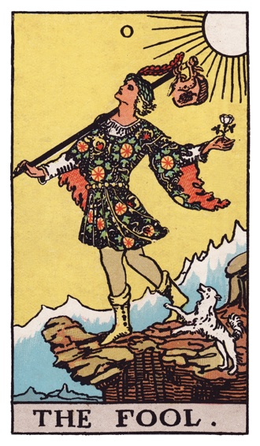
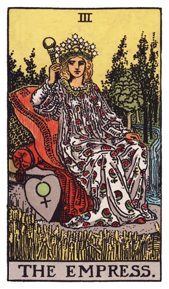
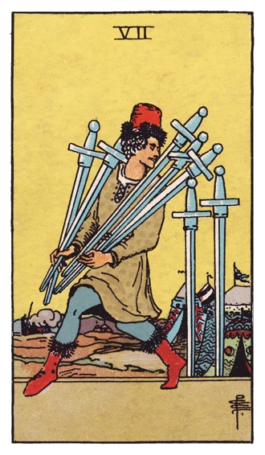
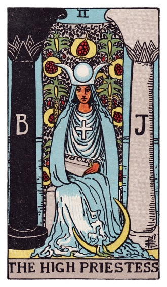

# Unconscious Development

  
  
  
  
  
  
  
  
  

A cast of agent archetypes takes an issue from approved spec to reviewed
diff. You approve the spec and the merge. In between, `spec-to-tasks` splits
the spec into tasks, a Creator implements each task in its own session and
worktree (a vessel), a Shadow checks the diff against the spec's acceptance
criteria, and a Trickster runs the criteria that reading can't settle.

The contract is files and scripts: Personas, specs, `🌀 Now/`
pages, `check-spec`, `spec-to-tasks`. No harness, tracker or runner is a
dependency.

Opt-in. Nothing here is loaded by default. `bin/unconscious enable` installs the cast into pi; `enable --harness claude` installs it into Claude Code.

`bin/unconscious help` lists every command, and `bin/unconscious help <command>` shows one command's options and examples. Each command's help lives in `src/help.ts`; a new command goes there too, or the tests fail.

New here? Start with the [Quickstart](docs/Quickstart.md), which takes one change from issue to merged PR. The [Glossary](docs/Glossary.md) says what each name means.

- [docs/Unconscious Development.md](docs/Unconscious%20Development.md): the working doc and current source of truth. As practices get their own file under `docs/`, the matching decisions leave it.
- `docs/archive/`: the interview doc and the composition drafts it grew from. Reference only.

## Scripts

Node 24, no dependencies. Run from a project repo; `-h` for options.

- `bin/unconscious init --domain NAME`: sets a repo up: `docs/specs/`, a draft Persona for the domain, and the CI workflow pinned to this checkout's commit. It never overwrites a file. Run with no flags on a terminal, it asks for the domain and confirms before writing.
- `bin/unconscious check-spec`: checks every spec and plan under `docs/specs/`, or a trivial issue's criteria with `--issue N`. With `--pr N` it also keeps one comment on that PR saying why the check fails, and rewrites it once the check passes; the workflow runs it that way.
- `bin/unconscious spec-to-tasks N`: turns issue N's plan (or its body, for the trivial tier) into tasks keyed `gh-N/t1`, through Bakery when `bakery-cli` is on the path, else printed for a plain session. `--dry-run` shows them without the state check.
- `bin/unconscious on-merge --base SHA`: flips the issue of each approved spec the merge touched to `ready-for-agent` and runs `spec-to-tasks`.
- `bin/unconscious task-merged --pr N`: after task PR N merges, if every task of its issue has a merged PR (one naming its key, `gh-42/t2`), sets the spec to `built`, removes its plan, and closes the issue, or moves it to `verifying` when the spec has after-deploy criteria. It pushes the spec change to the base branch, or opens a PR when the branch refuses.
- `bin/unconscious questions`: for every project page's repo, posts each open `[NEEDS CLARIFICATION]` on a spec PR as a review comment on its line, once, and turns a reply in that thread into the text that replaces its marker, committed to the PR branch. A small model reads the reply (`UD_INTERPRETER_MODEL`, default `anthropic/claude-haiku-5-5` at low thinking, through `pi`), so plain words like "yeah, go with 31" work; a reply in quotes or backticks goes in as written. The model only returns the replacement, the code puts it in that one span, and the thread shows the line before and after. A reply that asks back or is unclear changes nothing, and a later reply corrects the answer. A marker can be a short slot with the full question in a `> **Open:**` note on the line below; the comment asks the note's question, and the answer removes the note. Replies count from people with a stake in the repo (on GitHub: owner, members, collaborators), or only the logins in `UD_SELF` when set. It runs as you, through `gh`, every 2 minutes with `schedule on` (`UD_QUESTIONS_INTERVAL` seconds), about 19 GitHub API calls a run with five spec PRs open, so the commit starts the repo's CI like any push. The tracker verbs it uses are in `src/tracker/tracker.ts`; GitHub's adapter is `src/tracker/github.ts`.
- `templates/comments/`: the text of those comments (`question.md`, `answered.md`, `unclear.md`, `gone.md`, `check-failed.md`, `check-passed.md`). Copy one to `~/.config/unconscious/comments/` (or `$UD_COMMENT_TEMPLATES`) to change it. `{{card}}` is a Rider-Waite-Smith card from the `ud-assets` branch, floated left, drawn at random for a question and repeated on every reply in its thread; `{{card_name}}` is its name. The tag that lets the next run recognise a comment is added after the template.
- `workflows/unconscious.yml` and `workflows/unconscious-tasks.yml`: the CI workflows a project repo copies (`init` does) to run all of these. The second is separate because it runs on every merged PR that says `Refs`, not only those touching `docs/`.
- `bin/unconscious status-page`: rebuilds each `🌀 Now/<project>.md` page (any page with `repo:` in its frontmatter; `path:` to read specs, `ci:` to name the main workflow) and the Projects table in `🌀 Now/index.md`, whose Next column is each page's first proposal. Sections it doesn't write, like Proposed next, stay as they are.
- `skills/persona`: drafts a domain's Persona from the code, and promotes the invariants reviews propose.
- `skills/propose`: the Magician. Writes the Proposed next section of a Now page; run it in a session with "propose".
- `skills/issue`: starts the spec flow from an issue id. Finds the repo, picks the domain from its label or the Personas, opens the `spec/<n>` worktree, and makes the session that domain's Ruler. `/issue 6686` in pi, through `prompts/issue.md`, which `enable` links.
- `skills/build`: does an approved spec's tasks from an interactive session, one per run. Picks the next task from the plan, opens `.worktrees/gh-N-tK` (stacked on the parent task's PR branch while that PR is open), sends a Creator, a Shadow and a Trickster, and opens the task's PR. `/build 6983` in pi, through `prompts/build.md`. The alternative to Bakery cards.
- `bin/unconscious propose`: runs the Magician headless in `pi` over every Now page.
- `bin/unconscious review N [--comment]`: runs the Shadow headless on existing PR N, in a temporary worktree, against the criteria in the PR or its linked issues, or the ones the PR claims when none were written. A first try that needs no setup.
- `bin/unconscious draft N`: runs the Ruler headless in `pi` on issue N. A small issue gets its criteria written into its body and a comment asking for `ready-for-agent`; a bigger one gets a comment saying it needs a spec session. Adding `ready-for-agent` is the approval: the furthest-along state label wins, so `needs-spec` doesn't have to come off first.
- `bin/unconscious schedule on|mirror|off`: runs `status-page` every 15 minutes, `questions` every 2 and `propose` daily at 07:00 (`UD_PROPOSE_HOUR`), with launchd on macOS or systemd user timers on Linux. On Linux a missed `propose` runs when the host is back, and a failed one retries every 30 minutes. `schedule mirror` runs only `mirror` (the vault's Specs and Personas links, which Obsidian Sync can't carry) on the Mac you read the vault on, when another host runs the rest with `UD_VAULT_MIRROR=off`.
- `npm test`: the tests.

## The cast

| Card | Archetype | Role |
| --- | --- | --- |
|  | Self | You. Approves specs and merges. |
|  | Magician | `chief`. Reads every `PROJECT.md` and `🌀 Now/` page, proposes which issues to spec next. |
|  | Ruler | `lead`. Holds one domain's Persona, dispatches, writes specs, makes small changes. |
|  | Explorer | `explorer`. Reads anything, returns paths and lines, answers questions. |
|  | Sage | `sage`. Proposes steps and order, with a reason. |
|  | Creator | `creator`. Changes files, runs tests, reports. |
|  | Shadow | `shadow`. Sees what the Creator did not want seen; returns per-criterion verdicts with evidence. |
|  | Trickster | `trickster`. Runs the criteria the Shadow marked `needs-run` and tries to make them fail. |
|  | Persona | `docs/personas/<domain>.md`. The file any archetype reads first to become a specialist in that domain. |

Card images: Rider-Waite deck, 1909, public domain, via Wikimedia Commons.
