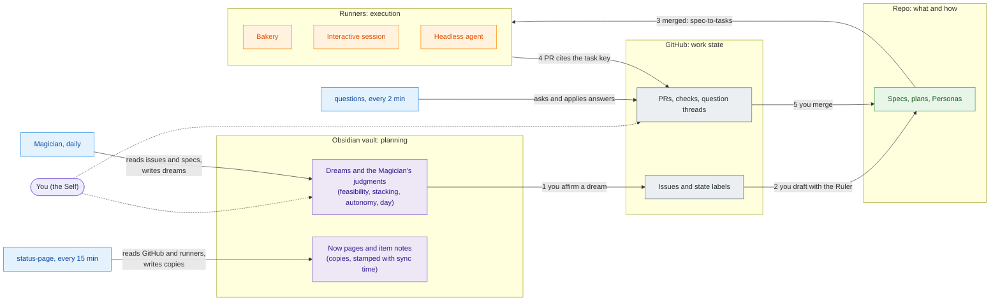
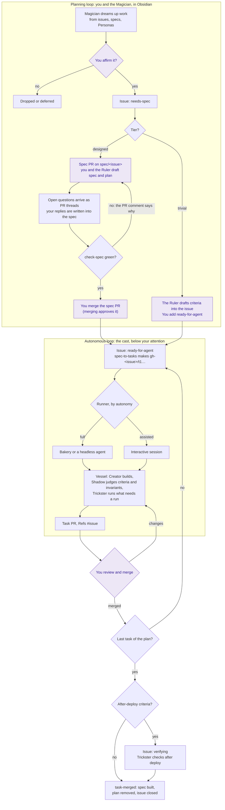

UD runs two loops. In the planning loop, you and the Magician decide what work exists, in Obsidian. In the autonomous loop, the cast turns affirmed work into PRs below your attention. You come back in only to review the PR.

## Who owns what

Each kind of state has one owner. Every other place that shows it is a copy with a sync time. The numbered arrows are one piece of work; the blue boxes are UD's jobs on your Mac.

## One piece of work, start to finish

The purple steps are yours. Everything else runs without you.

## Decided since

- A task is done when a merged PR names its key, or its plan box is ticked. `task-merged` finishes the issue from that.
- Who owns what, the key-named branches, and where dreams live: see [[Who owns what]].
