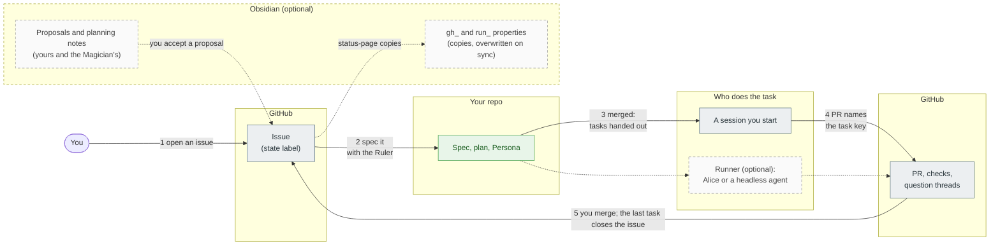
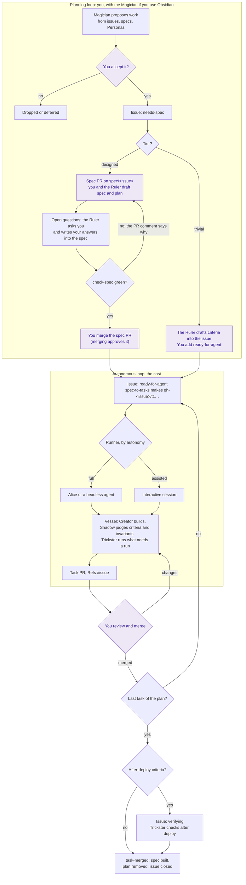

UD runs two loops. In the planning loop, you decide what work exists: on GitHub, or in Obsidian with the Magician if you use it. In the autonomous loop, the cast turns that work into PRs. You come back in only to review the PR.

## Where things live

GitHub and your repo are all you need. Obsidian and a runner are optional add-ons, drawn dashed. The numbered arrows are one piece of work.

## One piece of work, start to finish

The purple steps are yours. Everything else runs without you.

## Decided since

- A task is done when a merged PR names its key, or its plan box is ticked. `task-merged` finishes the issue from that.
- How UD, Alice, and Impression split the work, and where state lives: see [[Who owns what]].
